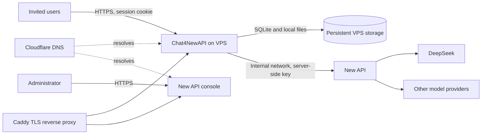

<div align="center">

# Chat4NewAPI

**A private, self-hosted AI chat workspace for New API**

One chat interface for the model providers you already manage in New API.
Keep credentials on the server, conversations on your VPS, and invite only the people you trust.

[简体中文](README.zh-CN.md) · [Features](#features) · [Architecture](#architecture) · [Deploy](#deploy-to-a-vps)

</div>

---

## What It Is

Chat4NewAPI is a self-hosted, multi-user chat frontend powered by [New API](https://github.com/QuantumNous/new-api). It adapts the open-source [DeepSeek chat-demo](https://github.com/deepseek-ai/chat-demo) experience into a server-backed application with accounts, persistent chat history, model selection, and an administrator console.

Configure an upstream once in New API, then let invited users choose from the models available to the gateway. Browser clients never receive provider keys or the New API token.

## Features

| Area | What Chat4NewAPI provides |
| --- | --- |
| Multi-provider chat | Select models exposed by New API and stream replies through a same-origin, authenticated server proxy. |
| Familiar chat workspace | Conversation history, branches, rename/delete, edit, regenerate, Markdown, syntax highlighting, KaTeX, and Mermaid. |
| Model-aware controls | Enable reasoning, search, files, vision, and voice per model; unsupported controls stay hidden. |
| Private accounts | First-run owner setup, invite-only account creation, disable/re-enable access, and per-user conversation isolation. |
| VPS-owned data | SQLite stores accounts, chats, usage, and configuration; uploaded originals live in a local persistent directory. |
| Operations | Docker Compose, Caddy-managed HTTPS, health checks, backup/restore, versioned images, and an interactive installer. |

DeepSeek search/read-link tools and file or audio APIs depend on the selected New API channel and upstream. Enable a capability only after testing that exact model route.

## Architecture



Cloudflare is used for DNS. Caddy obtains and renews HTTPS certificates. Chat4NewAPI and New API communicate over the private Compose network; New API's upstream providers are configured in its own admin console.

## Deploy to a VPS

### Requirements

- A public Ubuntu or Debian VPS with inbound TCP ports 80 and 443 available.
- Two DNS hostnames pointing to that VPS, for example `chat.example.com` and `newapi.example.com`.
- A public GitHub repository and its GHCR package set to public after the first image release.

Create the DNS records in Cloudflare first. Then run the installer as root on the VPS:

```sh
curl -fsSL https://raw.githubusercontent.com/OWNER/Chat4NewAPI/main/deploy/install.sh | sudo bash -s -- OWNER/Chat4NewAPI
```

The installer checks Ubuntu/Debian, installs Docker Engine on the VPS only when needed, asks for both hostnames, generates unique secrets, downloads the Compose files, and starts Chat4NewAPI, New API, and Caddy. It prints a one-time token used to initialize the Chat4NewAPI owner account. Do not lose the installer output before completing first-run setup.

### First run

1. Open the chat hostname and use the installer token to create the Chat4NewAPI owner account.
2. Open the New API hostname and complete New API's separate administrator setup.
3. Add provider channels and enable models in New API.
4. In Chat4NewAPI at `/admin`, configure the New API-issued token and internal URL `http://new-api:3000`.
5. Verify the model list, enable only the model capabilities you tested, then create invited user accounts.

Use Cloudflare Access to restrict the New API hostname to administrators. Cloudflare proxying is optional; if enabled, allow certificate validation traffic to reach the VPS.

## Operate

```sh
chat4newapi status
chat4newapi backup
chat4newapi update
chat4newapi update v1.0.0
chat4newapi restore
```

Data is stored under `/opt/chat4newapi/data`; backups are under `/opt/chat4newapi/backups`. Backups include the local database, attachments, New API data, deployment configuration, and encryption keys. Keep an additional copy off the VPS. Restore and data deletion require explicit confirmation; uninstall keeps data by default.

Protect `/opt/chat4newapi/.env`. It contains the encryption key for the stored New API token and deployment secrets. Losing it prevents decrypting that token.

## Develop and Test

Requirements: Node.js 22.12+ and pnpm 9.

```sh
pnpm install
APP_ENCRYPTION_KEY="$(openssl rand -hex 32)" pnpm dev
```

Open `http://localhost:8090`. The frontend proxies `/api` to the backend on port 3100. Create the initial owner, then configure a reachable New API URL and token in `/admin`.

```sh
pnpm type
pnpm lint
pnpm check:server
pnpm test
pnpm build
```

### Run the full stack in WSL

On Debian/Ubuntu WSL with systemd enabled, install Docker Engine and Compose in the Linux distribution (not Windows Docker Desktop):

```sh
sudo apt-get update
sudo apt-get install -y docker.io docker-compose
sudo systemctl enable --now docker
```

Create `deploy/.env` from `deploy/.env.example`, use `localhost` for both domains, and fill the four secrets with random hex values. Then build and start the chat and New API services with localhost-only test ports:

```sh
docker compose --env-file deploy/.env -f deploy/compose.yaml -f deploy/compose.wsl-test.yaml build chat
docker compose --env-file deploy/.env -f deploy/compose.yaml -f deploy/compose.wsl-test.yaml up -d chat new-api
```

Open the chat at `http://localhost:8090` and the New API console at `http://localhost:3001`. The WSL test override binds both ports to loopback only and does not start Caddy.

## Release Images

Push a version tag such as `v1.0.0`. GitHub Actions runs checks and publishes `linux/amd64` and `linux/arm64` images to `ghcr.io/OWNER/Chat4NewAPI`. The installer expects that package to be public. The deployment scripts fetched for an install or upgrade are taken from the matching Git ref.

## License

The chat UI is adapted from DeepSeek's MIT-licensed `chat-demo`. Preserve [LICENSE](LICENSE) and third-party notices when redistributing. New API, model-provider APIs, and models retain their respective licenses and terms.
