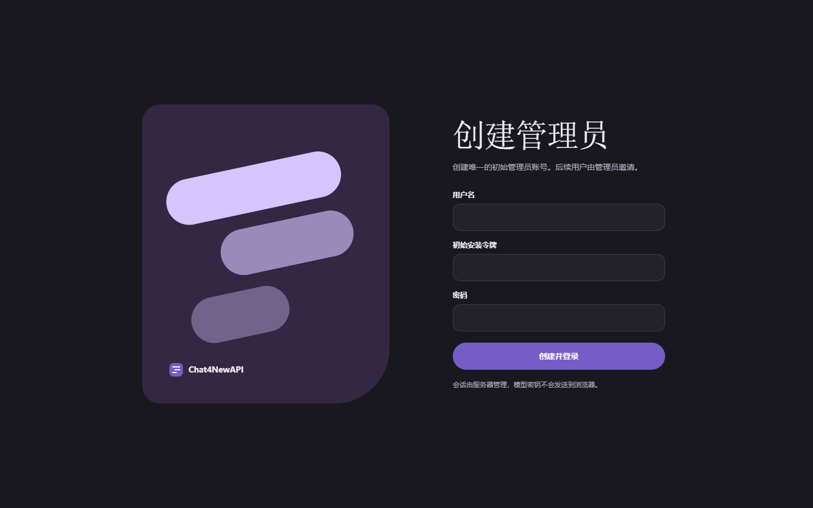

<div align="center">

# Chat4NewAPI

**A self-hosted AI chat workspace for the gateways you already run.**

One private chat app for Anthropic Messages, OpenAI Chat Completions, and OpenAI Responses APIs.

[](https://github.com/wdsjxj8451/Chat4NewAPI/stargazers)
[](package.json)
[](https://github.com/wdsjxj8451/Chat4NewAPI/releases)
[](LICENSE)
[](https://github.com/wdsjxj8451/Chat4NewAPI/actions/workflows/publish.yml)

[简体中文](README.zh-CN.md) · [Quick Start](#quick-start) · [API Compatibility](#api-compatibility) · [Operations](#operations) · [Development](#development) · [Releases](#releases-and-images)

</div>

---

## First-Run Experience



After setup, the administrator console configures the gateway protocol, model capabilities, shared prompt, and site appearance.

Chat4NewAPI adapts the open-source [DeepSeek chat-demo](https://github.com/deepseek-ai/chat-demo) into a private, multi-user workspace with server-managed accounts, persistent conversations, model selection, and an admin console. API keys stay on the server; conversations and uploaded originals stay in your own storage.

## API Compatibility

Choose the protocol your aggregator exposes in **Admin → Model service**. Chat4NewAPI normalizes the response stream for one chat UI, so users keep the same conversation experience when you switch gateways.

| Protocol | Upstream endpoint | Notes |
| --- | --- | --- |
| Anthropic Messages | `/v1/messages` | Native Messages forwarding, Files API, thinking, and compatible tools. |
| OpenAI Chat Completions | `/v1/chat/completions` | Streaming text and compatible reasoning/audio options. File, image, and search controls are hidden because this protocol path does not currently adapt them. |
| OpenAI Responses | `/v1/responses` | Streaming text/reasoning, Responses file references, and the built-in web search tool when the provider supports them. |

All protocols use the common `/v1/models` endpoint for discovery. New API, Sub2API, and other gateways work when they expose the selected compatible protocol. Endpoint availability, file handling, tools, reasoning, and audio remain provider-specific; the admin console hides controls known to be unsupported by the selected protocol.

**Current compatibility boundary:** Chat Completions supports streamed text and reasoning deltas. File and image inputs and search controls are currently available through Messages or Responses, not the Chat Completions adapter. The Responses adapter maps file references and web search; the gateway must support the OpenAI-compatible `/v1/files` and `/v1/responses` endpoints for those features.

## Features

- Private first-run admin setup, invite-only accounts, access controls, and per-user chat isolation.
- Persistent chats, branches, rename/delete, edit/regenerate, Markdown, code highlighting, KaTeX, and Mermaid.
- Per-model controls for reasoning, search, attachments, vision, and voice where supported.
- Admin-editable shared system prompt, site name, browser icon, and accent color.
- SQLite metadata, local attachment storage, encrypted gateway credentials, and backup/restore.
- Docker Compose, Caddy-managed HTTPS, health checks, GHCR images, and a one-command VPS installer.

## Quick Start

Requirements: Ubuntu or Debian VPS, Docker Compose, one DNS hostname, and a public GHCR package.

```sh
curl -fsSL https://raw.githubusercontent.com/wdsjxj8451/Chat4NewAPI/main/deploy/install.sh | sudo bash -s -- wdsjxj8451/Chat4NewAPI
```

The installer checks common local New API/Sub2API container names and ports. If it finds a service, it suggests its reachable API address. If not, it offers to pull the official New API image into a separate Compose project. Chat4NewAPI itself never bundles or depends on that gateway.

1. Point your chat DNS record at the VPS and allow inbound ports 80 and 443.
2. Run the installer and keep the one-time owner setup token it prints.
3. Open the chat site, create the administrator, then visit `/admin`.
4. Set the gateway name, protocol, base URL, and API key. Save and test the connection.
5. Verify model capabilities, adjust the shared prompt and appearance, then invite users.

For an independently installed New API dashboard, use an SSH tunnel to the VPS loopback port `3300`; it is not exposed publicly by the installer.

## Operations

```sh
chat4newapi status
chat4newapi backup
chat4newapi update
chat4newapi update v1.0.0
chat4newapi restore
```

Chat data lives in `/opt/chat4newapi/data`; backups are in `/opt/chat4newapi/backups`. A backup includes Chat4NewAPI's database, attachments, deployment files, and encryption key, but not data owned by an independent gateway. Keep an off-server copy of both gateway data and `/opt/chat4newapi/.env`.

To pin an install to a release, pass its version tag to the installer, for example `v1.2.0`. `chat4newapi update v1.2.0` upgrades to that image and refreshes the deployment files from the matching Git tag. A plain `chat4newapi update` tracks `main` and `latest`.

## Development

Requirements: Node.js 22.12+ and pnpm 9.

```sh
pnpm install
APP_ENCRYPTION_KEY="$(openssl rand -hex 32)" pnpm dev
```

Open `http://localhost:8090`. Configure a gateway reachable from the chat server; browser clients never connect to provider credentials directly.

```sh
pnpm test
pnpm type
pnpm lint
pnpm check:server
pnpm build
```

## Releases and Images

Push a `vX.Y.Z` tag to run the GitHub Actions checks and publish `linux/amd64` and `linux/arm64` images to `ghcr.io/wdsjxj8451/chat4newapi`. The installer script and Compose/Caddy deployment files live in [`deploy/`](deploy/); keep the GHCR package public for one-command installs. The package-version badge follows `package.json`; the release badge appears when a GitHub Release exists.

## License

MIT. The chat UI is adapted from DeepSeek's MIT-licensed `chat-demo`; preserve [LICENSE](LICENSE) and third-party notices when redistributing. Connected gateways, model-provider APIs, and models retain their own licenses and service terms.
