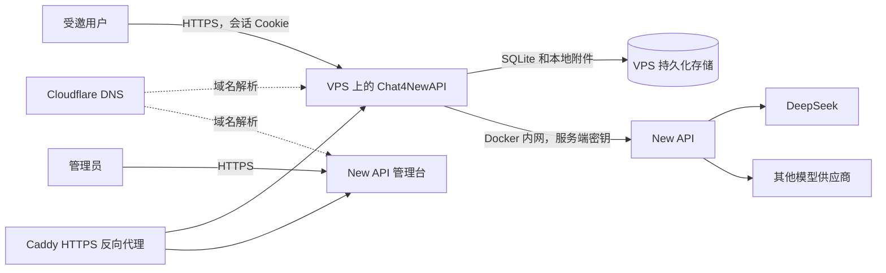

<div align="center">

# Chat4NewAPI

**基于 New API 的私有化、自托管 AI 聊天工作区**

一个网页聊天界面，连接你已在 New API 配置的模型服务。
密钥留在服务器，对话保存在 VPS，只邀请你信任的用户。

[English](README.md) · [项目特色](#项目特色) · [系统架构](#系统架构) · [一键部署](#vps-一键部署)

</div>

---

## 项目简介

Chat4NewAPI 是一个以 [New API](https://github.com/QuantumNous/new-api) 为模型网关的自托管、多用户网页聊天应用。它以 [DeepSeek 开源 chat-demo](https://github.com/deepseek-ai/chat-demo) 的体验为基础，增加服务端账号、持久化会话、模型切换和管理员控制台。

在 New API 中配置一次上游渠道，受邀用户即可使用网关开放的模型。浏览器不会获得供应商密钥或 New API 令牌。

## 项目特色

| 方向 | Chat4NewAPI 提供的能力 |
| --- | --- |
| 多模型聊天 | 切换 New API 暴露的模型；所有生成请求通过同源、需登录的服务端代理流式转发。 |
| 完整聊天工作区 | 会话历史、分支、重命名/删除、编辑/重新生成，以及 Markdown、代码高亮、公式和 Mermaid。 |
| 模型能力适配 | 按模型启用深度思考、搜索、文件、视觉和语音；未启用或不支持的控件不显示。 |
| 私有账号体系 | 首次创建站点管理员、邀请制创建账号、停用/恢复账号、用户间会话隔离。 |
| VPS 本地数据 | SQLite 保存账号、聊天、用量与配置；附件原件保存在 VPS 的持久化目录。 |
| 部署运维 | Docker Compose、Caddy 自动 HTTPS、健康检查、备份/恢复、版本镜像和交互式安装器。 |

DeepSeek 搜索/阅读工具以及文件、语音接口是否可用，取决于对应的 New API 通道和上游。请对每条模型路由实际验证后，再启用相应能力。

## 系统架构



Cloudflare 用于域名 DNS，Caddy 自动申请和续期 HTTPS 证书。Chat4NewAPI 与 New API 走 Docker Compose 私有网络；模型供应商渠道在 New API 管理控制台配置。

## VPS 一键部署

### 环境准备

- 一台公网可访问 80 和 443 端口的 Ubuntu/Debian VPS。
- 两个解析到 VPS 的域名，例如 `chat.example.com` 与 `newapi.example.com`。
- 一个公开 GitHub 仓库；首次发布镜像后将 GHCR Package 设置为公开。

先在 Cloudflare 创建 DNS 记录，然后在 VPS 上以 root 执行：

```sh
curl -fsSL https://raw.githubusercontent.com/OWNER/Chat4NewAPI/main/deploy/install.sh | sudo bash -s -- OWNER/Chat4NewAPI
```

安装器检查系统，只在 VPS 缺少 Docker 时安装 Docker Engine；随后询问两个域名、生成独立密钥、下载 Compose 配置并启动 Chat4NewAPI、New API 和 Caddy。安装结束会显示创建 Chat4NewAPI 初始管理员的一次性令牌，请在完成初始化前妥善留存。

### 首次配置

1. 打开聊天域名，用安装器输出的一次性令牌创建 Chat4NewAPI 管理员。
2. 打开 New API 域名，完成独立的 New API 管理员初始化。
3. 在 New API 添加供应商渠道并启用模型。
4. 在 Chat4NewAPI 的 `/admin` 页面填入 New API 令牌和内网地址 `http://new-api:3000`。
5. 检查模型列表，只启用实际验证过的模型能力，然后创建受邀用户。

建议使用 Cloudflare Access 限制 New API 管理域名。Cloudflare 代理可选；若启用，请确保 VPS 可接收证书验证所需流量。

## 运维命令

```sh
chat4newapi status
chat4newapi backup
chat4newapi update
chat4newapi update v1.0.0
chat4newapi restore
```

数据位于 `/opt/chat4newapi/data`，备份位于 `/opt/chat4newapi/backups`。备份包含本地数据库、附件、New API 数据、部署配置和加密密钥。请另存一份到 VPS 以外。恢复和删除数据需要明确确认；卸载默认保留数据。

请保护 `/opt/chat4newapi/.env`。它含有 New API 令牌的加密密钥及部署密钥；若丢失，将无法解密已保存的令牌。

## 本地开发与测试

需要 Node.js 22.12+ 和 pnpm 9。

```sh
pnpm install
APP_ENCRYPTION_KEY="$(openssl rand -hex 32)" pnpm dev
```

打开 `http://localhost:8090`。前端会把 `/api` 转发给 3100 端口的后端。首次创建管理员后，在 `/admin` 配置可访问的 New API 地址和令牌。

```sh
pnpm type
pnpm lint
pnpm check:server
pnpm test
pnpm build
```

### 在 WSL 运行完整服务

Debian/Ubuntu WSL 需启用 systemd；Docker Engine 与 Compose 安装在 Linux 发行版中，不安装 Windows Docker Desktop：

```sh
sudo apt-get update
sudo apt-get install -y docker.io docker-compose
sudo systemctl enable --now docker
```

从 `deploy/.env.example` 创建 `deploy/.env`，两个域名设为 `localhost`，并填入四个随机十六进制密钥。随后构建聊天容器并启动聊天站和 New API：

```sh
docker compose --env-file deploy/.env -f deploy/compose.yaml -f deploy/compose.wsl-test.yaml build chat
docker compose --env-file deploy/.env -f deploy/compose.yaml -f deploy/compose.wsl-test.yaml up -d chat new-api
```

聊天站地址为 `http://localhost:8090`，New API 管理台地址为 `http://localhost:3001`。WSL 测试覆盖只绑定本机回环地址，不启动 Caddy。

## GitHub 镜像发布

推送 `v1.0.0` 形式的版本标签后，GitHub Actions 会先运行检查，再构建并发布 `linux/amd64`、`linux/arm64` 镜像到 `ghcr.io/OWNER/Chat4NewAPI`。请将镜像包设置为公开。安装和升级使用对应 Git ref 中的部署脚本。

## 许可

聊天界面基于 DeepSeek 的 MIT 许可 `chat-demo` 改造。再分发时请保留 [LICENSE](LICENSE) 和第三方声明。New API、模型供应商 API 与模型仍遵循各自许可证及服务条款。
