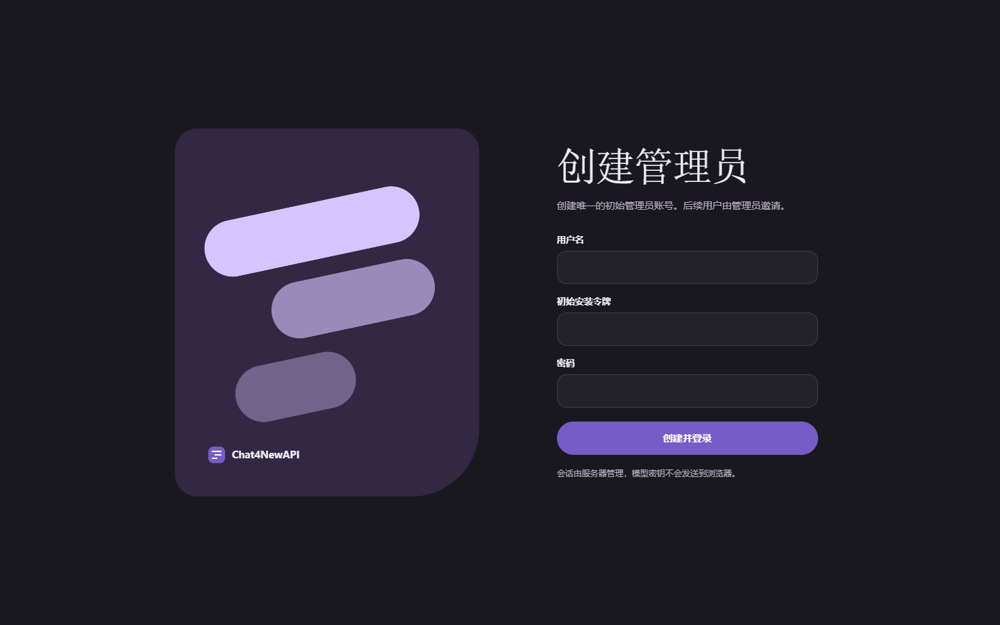

<div align="center">

# Chat4NewAPI

**为你已部署的模型网关打造的自托管 AI 聊天工作区**

一个私有聊天站，支持 Anthropic Messages、OpenAI Chat Completions 与 OpenAI Responses。

[](https://github.com/wdsjxj8451/Chat4NewAPI/stargazers)
[](package.json)
[](https://github.com/wdsjxj8451/Chat4NewAPI/releases)
[](LICENSE)
[](https://github.com/wdsjxj8451/Chat4NewAPI/actions/workflows/publish.yml)

[English](README.md) · [快速部署](#快速部署) · [协议兼容](#协议兼容) · [运维](#运维) · [开发与测试](#开发与测试) · [GitHub 发布](#github-发布与镜像)

</div>

---

## 首次启动体验



初始化后，管理员可在控制台选择网关协议、管理模型能力，并设置全站提示词和站点外观。

Chat4NewAPI 基于开源 [DeepSeek chat-demo](https://github.com/deepseek-ai/chat-demo) 构建，增加了私有账号、持久化会话、模型选择和管理控制台。API 密钥只保存在服务端；对话和上传文件保存在你自己的服务器。

## 协议兼容

在「管理控制台 → 模型服务」中选择聚合平台提供的协议。服务端将响应流转换为聊天前端统一使用的事件格式；更换网关时，用户仍使用同一套对话界面。

| 协议 | 上游接口 | 说明 |
| --- | --- | --- |
| Anthropic Messages | `/v1/messages` | 原生转发 Messages、Files、思考和兼容工具。 |
| OpenAI Chat Completions | `/v1/chat/completions` | 支持流式文本及兼容的推理/语音能力。此协议暂不适配文件、图片和联网搜索，因此会隐藏这些控件。 |
| OpenAI Responses | `/v1/responses` | 支持流式文本/推理、Responses 文件引用，以及服务端支持时的内置联网搜索。 |

所有协议均使用通用的 `/v1/models` 接口发现模型。New API、Sub2API 及其他网关，只要提供所选兼容协议即可接入。接口可用性、文件处理、工具、推理和语音能力仍由聚合平台决定；管理台会隐藏所选协议已知不支持的能力控件。

**当前兼容边界：** Chat Completions 支持流式文本和推理增量；文件/图片输入及搜索控件目前通过 Messages 或 Responses 协议提供。Responses 适配文件引用和联网搜索；对应网关需要兼容 `/v1/files` 与 `/v1/responses`。

## 功能

- 首次管理员初始化、邀请制账号、访问控制和用户间会话隔离。
- 持久化对话、分支、重命名/删除、编辑/重新生成，以及 Markdown、代码高亮、KaTeX 和 Mermaid。
- 按模型启用推理、搜索、附件、视觉和语音等能力。
- 管理员可自定义全站系统提示词、站点名称、浏览器图标和强调色。
- SQLite 保存业务数据，附件存储在本地，网关密钥加密保存，支持备份/恢复。
- Docker Compose、Caddy 自动 HTTPS、健康检查、GHCR 镜像和一键 VPS 安装脚本。

## 快速部署

需要 Ubuntu/Debian VPS、Docker Compose、一个 DNS 域名，并将 GHCR 镜像包设为公开。

```sh
curl -fsSL https://raw.githubusercontent.com/wdsjxj8451/Chat4NewAPI/main/deploy/install.sh | sudo bash -s -- wdsjxj8451/Chat4NewAPI
```

安装器会检查常见 New API/Sub2API 容器名与端口。发现服务后会建议可达的 API 地址；未发现时，可选择把官方 New API 镜像安装到独立 Compose 项目。Chat4NewAPI 本身不捆绑、不依赖该网关。

1. 将聊天域名解析到 VPS，并开放 TCP 80、443 端口。
2. 运行安装器，留存输出的一次性管理员初始化令牌。
3. 打开聊天站创建管理员，再进入 `/admin`。
4. 填写网关名称、协议、基础地址和 API 密钥，保存并测试连接。
5. 验证模型能力，调整系统提示词和外观，再邀请用户。

若安装器独立部署了 New API，其管理面板只绑定 VPS 的 `127.0.0.1:3300`，请通过 SSH 隧道访问，不会暴露到公网。

## 运维

```sh
chat4newapi status
chat4newapi backup
chat4newapi update
chat4newapi update v1.0.0
chat4newapi restore
```

Chat4NewAPI 数据位于 `/opt/chat4newapi/data`，备份位于 `/opt/chat4newapi/backups`。备份包含本站数据库、附件、部署文件和加密密钥，但不包含独立网关的数据。请将网关数据和 `/opt/chat4newapi/.env` 另行备份到服务器之外。

如需固定安装版本，可在安装命令中传入版本标签，例如 `v1.2.0`。`chat4newapi update v1.2.0` 会升级到对应镜像，并从对应 Git 标签更新部署文件。不带版本的 `chat4newapi update` 跟踪 `main` 与 `latest`。

## 开发与测试

需要 Node.js 22.12+ 和 pnpm 9。

```sh
pnpm install
APP_ENCRYPTION_KEY="$(openssl rand -hex 32)" pnpm dev
```

打开 `http://localhost:8090`。配置聊天服务端可访问的网关地址；浏览器不会直接连接或持有供应商密钥。

```sh
pnpm test
pnpm type
pnpm lint
pnpm check:server
pnpm build
```

## GitHub 发布与镜像

推送 `vX.Y.Z` 版本标签后，GitHub Actions 运行检查，并发布 `linux/amd64` 和 `linux/arm64` 镜像至 `ghcr.io/wdsjxj8451/chat4newapi`。一键安装脚本及 Compose/Caddy 部署文件均位于 [`deploy/`](deploy/)。请将 GHCR 镜像包设为公开。软件包版本徽章跟随 `package.json`；创建 GitHub Release 后，最新发行版徽章才会显示版本。

## 许可证

本项目采用 MIT 许可证。聊天界面基于 DeepSeek 的 MIT 许可 `chat-demo` 改造；再分发时请保留 [LICENSE](LICENSE) 和第三方声明。所连接的网关、模型供应商 API 和模型遵循其各自许可证与服务条款。
